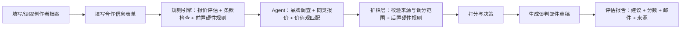
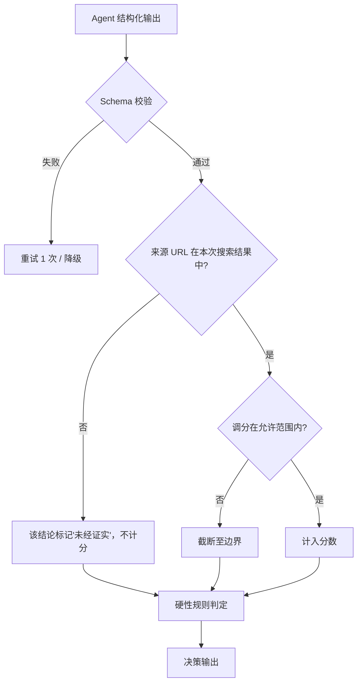

# DealCheck Agent 产品需求文档（PRD）

| 项目 | 内容 |
|---|---|
| 产品名 | DealCheck Agent |
| 版本 | V2.0（MVP） |
| 文档状态 | 草稿（Draft） |
| 最后更新 | 2026-10-26 |
| 产品定位 | 帮创作者做收入决策的 AI 助手（AI Income Decision Assistant for Creators） |

---

## 目录

1. 背景与问题
2. 目标用户
3. V1 与 V2 对比
4. 产品目标与范围
5. 核心功能
6. 为什么用混合架构（Hybrid Architecture）
7. 打分与决策模型
8. 护栏设计（Guardrails）
9. Agent 工具清单（Tool Inventory）
10. 系统架构与模型封装
11. 建议边界与合规
12. 不做什么（Non-goals）
13. 成功指标（Success Metrics）
14. 评测计划（Evaluation Plan）
15. 风险与应对
16. 实施里程碑（Milestones）
17. 版本规划（Roadmap）
18. 附录

---

## 1. 背景与问题

### 1.1 背景

品牌合作（Brand Deal）是中小创作者最主要的变现方式之一。粉丝量过了一千左右，创作者就会陆续收到品牌方的合作邀请，通常是一封邮件或私信，里面有报价、交付要求（Deliverables），有时附一份合同。

头部创作者有经纪人（Talent Manager）或 MCN 帮忙谈价、审合同、做品牌背调。中小创作者基本只能自己处理，而且他们面对的是信息差很大的局面：品牌方知道自己给其他创作者开多少钱，创作者不知道。

### 1.2 核心问题

收到合作邀请后，创作者要回答四个问题，每个都难：

| 问题 | 难点 | 后果 |
|---|---|---|
| **报价合理吗？** | 市场价不透明，同行之间很少公开报价 | 长期低价接单，或者报价过高把合作谈崩 |
| **合同有没有坑？** | 不熟悉独家期（Exclusivity）、使用权（Usage Rights）、撤单费（Kill Fee）这些条款的行业惯例 | 内容被品牌永久投放广告却拿不到额外收入；被独家条款锁住，错过其他合作 |
| **品牌靠谱吗？** | 没有时间和方法做背景调查 | 遇到拖欠付款、诈骗、口碑差的品牌，钱和声誉都受损 |
| **和我的调性合不合？** | 判断主观，又容易被短期收入影响 | 接了和自己价值观冲突的合作，粉丝信任下降 |

### 1.3 问题本质

这是一个**带不确定性的收入决策问题**：

- 一部分判断有明确标准，可以用规则精确算出来（报价和基准比偏离多少、条款是否超出行业惯例）。
- 另一部分要临时去调查、做开放式判断（这个品牌最近口碑如何、同类创作者实际拿多少钱、品牌主张和创作者价值观冲不冲突）。

单靠规则覆盖不了后者，单靠大模型做前者又不稳定、不可复现。这是 V2 采用混合架构的出发点（详见第 6 节）。

---

## 2. 目标用户

### 2.1 用户画像

| 维度 | 描述 |
|---|---|
| 粉丝规模 | 1K–500K，分为 5 个量级：Nano 1K–10K / Micro 10K–50K / Mid 50K–100K / Mid+ 100K–250K / Upper 250K–500K（定义见附录 A） |
| 平台 | Instagram / TikTok / YouTube（MVP 只做海外英文市场） |
| 合作方式 | 没有经纪人或 MCN，自己谈合作 |
| 合作频率 | 每月 0–10 个邀请 |
| 典型特征 | 内容是主业或重要副业；对商业条款了解有限；在意粉丝信任；时间紧 |

### 2.2 典型用户

- **Maya，Micro 级美妆博主（Instagram，28K 粉丝）**：每月收到 3–5 个邀请，不知道一条 Reel 收 $300 算高还是低，以前签过一份"永久使用权"合同，后来发现自己的视频被品牌拿去投了半年广告。
- **Leo，Nano 级科技博主（YouTube，6K 订阅）**：刚开始收到合作邀请，分不清哪些是真品牌、哪些是骗局（例如先要求他付钱买产品的"合作"）。
- **Priya，Mid+ 级健身博主（TikTok，180K 粉丝）**：邀请多到处理不过来，想快速筛掉不合适的，把精力放在值得谈的合作上；她不接酒精和减肥药类品牌。

### 2.3 核心用户故事（User Stories）

| 编号 | 作为…… | 我想…… | 以便…… |
|---|---|---|---|
| US-1 | 创作者 | 输入一个合作邀请，得到"接受 / 谈判 / 拒绝"的建议和理由 | 快速做决定 |
| US-2 | 创作者 | 知道这个报价相对市场价高还是低、低多少 | 心里有数地去谈价 |
| US-3 | 创作者 | 看到合同里哪些条款有风险、为什么有风险 | 避免签下不利条款 |
| US-4 | 创作者 | 了解品牌的背景和口碑，并且能看到信息来源 | 判断品牌是否可信 |
| US-5 | 创作者 | 拿到一封可以直接修改后发出的英文谈判邮件 | 省去写邮件的时间，也不怕措辞不专业 |
| US-6 | 创作者 | 保存我的档案（粉丝量、领域、拒接品类） | 每次评估不用重复填写 |

---

## 3. V1 与 V2 对比

### 3.1 V1 回顾

V1 是一个单页 HTML 小工具：

1. 用户填写创作者档案和合作信息；
2. 前端规则对比市场价、给合同条款标红黄灯；
3. 生成一段 Prompt，用户**手动复制**到 Claude 聊天界面；
4. 用户再把大模型的回答**手动粘贴**回来。

本质上是"规则 + 人工把数据搬给大模型"的工作流（Workflow），不是 Agent。

### 3.2 对比

| 维度 | V1：规则 + 人工搬运 | V2：混合架构 Agent |
|---|---|---|
| 架构 | 前端规则 + 手动 Prompt | 规则引擎（Rule Engine）+ LLM Agent + 护栏层（Guardrails） |
| 大模型调用 | 用户手动复制粘贴 | 后端自动调用，Agent 自主决定调用哪些工具 |
| 品牌调查 | 无，或靠模型训练数据中的过时记忆 | Agent 实时联网搜索，结论附来源 |
| 同类报价 | 只有静态基准表 | 基准表 + Agent 搜索到的公开真实报价作为补充 |
| 价值观匹配 | 无 | Agent 对比品牌主张与创作者档案 |
| 打分 | 无统一分数 | 规则加权计算基础分，Agent 限定范围内调分，每次调分必须附来源 |
| 决策结论 | 用户自己综合判断 | 输出"接受 / 谈判 / 拒绝"，有硬性规则兜底 |
| 谈判邮件 | 无，或需另行要求模型写 | 自动起草英文邮件，数字来自规则计算，不能由模型编造 |
| 可信度 | 无法追溯模型说法的出处 | 每条外部信息都有来源列表（Sources） |
| 部署 | 本地 HTML 文件 | 网页应用，线上部署，代码开源在 GitHub |
| 模型依赖 | 绑定在 Claude 聊天界面 | 模型调用单独封装，默认用 DeepSeek，可以切换到 Claude 等其他模型 |
| 用户操作步数 | 约 6 步（含两次复制粘贴） | 2 步（填表 → 看报告） |

### 3.3 V2 要验证的假设

1. **H1**：混合架构比"只用规则"或"只用 Agent"做出的决策更准确、更可信（通过消融实验验证，见第 14 节）。
2. **H2**：给每条外部信息附来源，能明显提高用户对建议的信任度。
3. **H3**：自动起草、数字准确的谈判邮件，是用户最愿意直接拿去用的产出。

> H2、H3 原计划通过创作者访谈验证。V2.0 不做访谈（移到第 17 节"未来计划"），这两条暂不验证；有真实使用后，可以从 13.5 节的来源链接点击率、邮件复制率间接观察。

---

## 4. 产品目标与范围

### 4.1 产品目标

| 类型 | 目标 |
|---|---|
| 用户价值 | 把评估一个合作邀请的时间从 30–60 分钟降到 3 分钟以内，并让决策有依据、可追溯 |
| 产品质量 | 决策和标准答案的一致率 ≥ 80%；硬性规则场景 100% 正确拦截 |
| 工程目标 | 做出一个可线上访问、可复现、模型可替换的 Agent 应用 |

### 4.2 MVP 范围

| 优先级 | 功能 |
|---|---|
| **P0（MVP 必做）** | 创作者档案；结构化表单输入合作信息；报价评估（规则）；合同条款红黄灯（规则）；品牌背景调查（Agent）；同类报价搜索（Agent）；价值观匹配（Agent）；综合打分与决策；护栏；谈判邮件草稿；来源列表；免责声明；模型调用封装；线上部署 |
| **P1（下一迭代）** | 粘贴合同原文，由 LLM 抽取条款，用户核对确认；付款周期（Payment Terms）规则；报告导出；评估历史记录 |
| **P2（远期）** | 多轮谈判跟进（根据品牌回复生成下一封邮件）；基准表众包更新 |
| **V3** | 本地化到小红书、抖音（见第 17 节） |

---

## 5. 核心功能

### 5.1 用户流程



### 5.2 F1 创作者档案（Creator Profile）

用户第一次使用时填写，之后每次评估自动读取。MVP 存在浏览器本地（localStorage），不建账号体系。

| 字段 | 类型 | 必填 | 说明 |
|---|---|---|---|
| 昵称 / Handle | 文本 | 是 | 用于邮件署名 |
| 平台与粉丝量 | 多组（平台 + 数字） | 是 | 决定粉丝量级（Tier） |
| 平均互动率（Engagement Rate） | 百分比 | 是 | 影响报价基准修正系数 |
| 内容领域（Niche） | 单选 | 是 | 8 个领域，见附录 A |
| 受众主要地区 | 多选 | 否 | 用于判断品牌市场是否匹配 |
| 价值观与偏好 | 多选标签 + 自由文本 | 否 | 例如 cruelty-free、sustainability、family-friendly |
| 拒接品类（Blocked Categories） | 多选（标准清单） | 否 | 从标准敏感品类清单中选择（见 8.1 节）；命中触发 HR-1，**直接建议拒绝** |
| 其他拒接品类（Custom Blocked Items） | 自由填写，最多 10 项 | 否 | 标准清单覆盖不到的品类，例如"含咖啡因的能量饮料"。由 Agent 做语义判断，可靠性较低，命中只触发封顶类规则 HR-8（最多到谈判），并提示用户自行核实 |
| 最低接单价（Rate Floor） | 金额（USD） | 否 | 低于这个价位，决策最多到"谈判" |
| 历史报价 | 可选列表 | 否 | 作为个人基准参考 |

### 5.3 F2 合作信息输入（Deal Input，结构化表单）

MVP 只做结构化表单。字段设计的原则是：每个字段都能被规则直接使用。

| 分组 | 字段 | 说明 |
|---|---|---|
| 品牌信息 | 品牌名、官网 URL、品牌社媒账号、产品品类 | 官网或账号用来消除同名品牌歧义，强烈建议填写 |
| 交付内容 | 平台、内容形式（Reel / Feed Post / Story / TikTok Video / YouTube Integration / YouTube Dedicated Video）、数量 | 可以添加多项 |
| 报价 | 现金报价（USD）、是否附赠产品及价值 | 赠品不计入现金报价，单独展示 |
| 独家期（Exclusivity） | 天数、范围（无 / 同品类竞品 / 全行业） | |
| 使用权（Usage Rights） | 类型（仅自然发布 Organic / 付费投放 Paid Ads / 白名单 Whitelisting）、时长（天）、是否永久（Perpetual）、**付费使用是否单独计费**（Paid Usage Billed Separately） | 付费投放或白名单没有填时长，视为"合同未写明期限" |
| 撤单费（Kill Fee） | 百分比（0–100%），或"未提及" | |
| 修改次数（Revisions） | 次数，或"无限次" | |
| 风险信号 | 是否要求创作者预付任何费用（购买产品、保证金、"培训费"等） | 勾选"是"会触发硬性规则 |
| 其他 | 截止日期、补充说明 | 补充说明只作为 Agent 的参考上下文，不参与规则计算 |

### 5.4 F3 报价评估（规则）

1. 根据平台 × 粉丝量级 × 领域 × 内容形式，从市场价基准表查出 P25 / P50 / P75 区间。
2. 用互动率修正系数和使用权 / 独家期溢价系数，算出**调整后基准价（Adjusted Benchmark）**。
3. 计算**报价比（Offer Ratio）= 报价 ÷ 调整后基准 P50**。
4. 输出：报价比、所在区间位置、建议还价区间（默认以调整后基准的 P50–P75 为目标）。

> 建议还价金额**只能由规则算出**。邮件草稿里出现的所有金额都必须来自这一步（见护栏 G5）。

### 5.5 F4 合同条款检查（规则）

| 条款 | 绿灯 | 黄灯 | 红灯 |
|---|---|---|---|
| 独家期 | ≤ 30 天且仅限同品类竞品 | 31–90 天；或全行业独家 ≤ 30 天 | > 90 天；或全行业独家 > 30 天 |
| 使用权 | 仅自然发布；或付费投放 / 白名单 ≤ 30 天（无论是否单独计费） | 付费投放 / 白名单 31–180 天（无论是否单独计费）；或超过 180 天但单独计费 | 永久使用权（Perpetual，无论是否单独计费）；或超过 180 天且没有单独计费；或付费使用未写明期限 |
| 撤单费 | ≥ 50% | 25%–49% | < 25% 或未提及 |
| 修改次数 | ≤ 2 次 | 3 次 | ≥ 4 次或无限次 |

每个红灯或黄灯都要附：**一句话解释为什么有风险**，以及**一句话建议怎么改**（例如"Request usage rights limited to 30 days of paid usage, or an additional usage fee"）。阈值写在配置文件里，不写死在代码中。

### 5.6 F5 品牌背景调查（Agent）

Agent 用网页搜索调查以下内容，结论结构化输出：

- **实体确认**：搜到的品牌和用户填写的官网 / 账号是否是同一家（避免同名混淆）；
- **基本面**：成立时间、规模、主营产品、主要市场；
- **创作者口碑**：有没有拖欠付款、不守约、强行改稿的公开反馈（Reddit、创作者社区、新闻等）；
- **公共负面**：诈骗指控、监管处罚、产品安全问题、重大舆情；
- **风险等级**：无 / 轻微 / 中等 / 严重，每个等级都必须对应有据可查的证据。

### 5.7 F6 同类报价搜索（Agent）

Agent 搜索公开渠道中同平台、同量级、同领域创作者的真实报价（例如创作者自己公开的报价、行业报告、媒体报道），用于：

- 对静态基准表做**时效性补充**；
- 如果搜到的报价和基准表差异明显，在报告里同时展示两者，并在限定范围内调分（见第 7 节）。

搜索结果只作为参考，**不会写回基准表**。

### 5.8 F7 价值观匹配（Agent）

Agent 对比品牌的产品、营销主张、公开争议，以及创作者档案里的价值观标签和受众，判断匹配程度：

- 输出：高 / 中 / 低匹配，以及具体的冲突点或契合点；
- 如果品牌品类命中创作者的拒接品类，由**规则**直接判定（硬性规则 HR-1），不交给 Agent 判断。

### 5.9 F8 综合建议与打分

报告首屏是**决策卡片（Decision Card）**：

- 决策：**Accept / Negotiate / Decline**（界面用英文，以下统称"接受 / 谈判 / 拒绝"）；
- 总分（0–100）和各维度得分；
- 一句话核心理由；
- 如果触发了硬性规则，醒目显示是哪一条，以及触发它的证据。

再往下依次是：分数明细（每一项可以展开看规则或来源）、条款红黄灯、品牌调查摘要、同类报价参考、匹配度分析、谈判要点。

### 5.10 F9 谈判邮件草稿（Agent 生成 + 规则约束）

- 根据决策生成英文邮件：**接受**时是确认邮件，写明关键条款；**谈判**时是还价邮件，提出具体修改要求；**拒绝**时是礼貌的婉拒邮件。
- 邮件里的金额、天数、百分比**全部来自规则计算结果**，由模板变量注入，生成后再做一次一致性校验。
- 语气专业、友好、不卑不亢；不承诺任何创作者没确认过的事项。
- **只起草，不发送**：界面上提供可编辑文本框和"复制"按钮，系统没有任何发送邮件的能力。

### 5.11 F10 信息来源列表（Sources）

- 列出 Agent 用到的每条外部信息：标题、URL、访问日期、用来支持哪条结论；
- 报告正文里的结论用角标 [1][2] 链到对应来源；
- 基准表数据也标注来源和数据日期。

---

## 6. 为什么用混合架构（Hybrid Architecture）

### 6.1 分工原则

> **能写成明确规则的判断交给规则；需要临时调查、处理开放信息的判断交给 Agent；最终决策权留在规则和护栏手里。**

判断一项任务该交给谁，看三个标准：

1. **是否有明确标准**：标准能写成阈值或公式的，交给规则。
2. **是否需要实时外部信息**：信息不在用户输入和内置数据里、需要去搜的，交给 Agent。
3. **出错的代价和可复现要求**：会直接影响"接受 / 拒绝"、出错代价高的，要么交给规则，要么由规则兜底。

### 6.2 分工明细

| 任务 | 负责方 | 理由 |
|---|---|---|
| 报价 vs 市场价基准 | **规则** | 查表加公式，结果必须稳定、可复现；大模型做数值比较容易出错 |
| 合同条款风险判定 | **规则** | 行业惯例可以写成阈值；同样的输入必须得到同样的红黄灯 |
| 建议还价金额 | **规则** | 金额直接影响收入，不能由模型"估"出来 |
| 拒接品类 / 预付费用拦截 | **规则** | 用户已经明确表达的底线，零容忍，不需要也不应该让模型判断 |
| 打分与决策阈值 | **规则** | 决策逻辑需要透明、可解释、可审计 |
| 品牌背景与口碑调查 | **Agent** | 信息分散在网上、随时变化，要多轮搜索和阅读理解，写不成规则 |
| 同类创作者真实报价 | **Agent** | 公开报价零散、格式不统一，要搜索、筛选、判断是否可比 |
| 价值观匹配 | **Agent** | 需要理解语义和上下文（例如"清洁美妆"品牌和"cruelty-free"偏好之间的关系） |
| 谈判邮件措辞 | **Agent** | 自然语言写作是大模型擅长的；但其中的数字受规则约束 |
| 校验 Agent 输出 | **规则（护栏）** | 不能让模型自己检查自己 |

### 6.3 为什么不只用规则

V1 已经证明了规则的天花板：品牌口碑、最新市场行情、价值观匹配这三件事，靠静态规则和静态数据做不了。而这些恰恰是创作者最没有能力自己查的部分。

### 6.4 为什么不只用 Agent

| 只用 Agent 的问题 | 后果 |
|---|---|
| 同样的输入，多次运行结论可能不一样 | 用户无法信任，也没法回归测试 |
| 数值计算和比较不可靠 | 报价判断错误，直接造成收入损失 |
| 可能编造品牌信息或报价 | 误导决策，甚至产生声誉 / 法律风险 |
| 决策过程是黑箱 | 不可解释，不符合第 11 节的建议边界要求 |
| 成本和时延更高 | 规则能瞬间完成的工作，也要消耗 token |

### 6.5 混合架构的价值

- **确定性部分零幻觉**：报价、条款、金额全部可复现；
- **不确定部分有据可查**：Agent 每个结论都附来源；
- **决策权可控**：Agent 影响分数的幅度被限定，硬性规则 Agent 推翻不了；
- **可降级（Graceful Degradation）**：搜索或模型不可用时，系统退回"仅规则模式"，仍然能给出基础评估，并明确告诉用户哪些部分缺失。

---

## 7. 打分与决策模型

### 7.1 基础分（规则计算，0–100）

| 维度 | 满分 | 计算方式 |
|---|---|---|
| 报价合理性（Pricing） | 45 | 按报价比分档：≥ 1.0 → 45；0.8–1.0 → 35；0.6–0.8 → 22；0.4–0.6 → 10；< 0.4 → 0 |
| 合同条款（Contract） | 35 | 从 35 开始扣分：每个红灯 −10，每个黄灯 −4，最低 0 |
| 品牌与匹配（Brand & Fit） | 20 | 默认 12 分（中性，表示"未知"），完全由 Agent 的有据调分决定增减，范围 0–20 |

> 分档阈值和扣分值都写在配置里，MVP 上线前会用评测集校准。

### 7.2 Agent 调分（限定范围，必须附来源）

| 调分项 | 允许范围 | 触发依据示例 |
|---|---|---|
| 品牌口碑 | −8 ~ +4 | 多位创作者反映拖欠付款 → 负分；长期和创作者合作、口碑好 → 正分 |
| 价值观匹配 | −6 ~ +4 | 品牌主张和创作者价值观冲突 → 负分；高度契合 → 正分 |
| 同类报价修正 | −5 ~ +5 | 搜到的可比报价明显高于基准表 → 报价维度下调；明显低于 → 上调 |
| **单次评估调分总额上限** | **±15** | 超出部分截断 |

每一项调分必须同时满足：

1. 至少附 1 条可访问的来源 URL；
2. 附一句话说明调分理由，并且能在来源中找到依据；
3. 落在允许范围内。

任何一条不满足，护栏层**直接把这项调分作废（按 0 处理）**，并在报告里注明"该项因缺少有效来源未计入"。

### 7.3 决策规则

```
1. 命中任一"拒绝类"硬性规则          → 拒绝（Decline），不再看分数
2. 总分 ≥ 75 且未命中"封顶类"硬性规则 → 接受（Accept）
3. 总分 ≥ 75 但命中"封顶类"硬性规则   → 谈判（Negotiate）
4. 50 ≤ 总分 < 75                    → 谈判（Negotiate）
5. 总分 < 50                         → 拒绝（Decline），同时给出"如果对方满足 X 条件可以重新考虑"
```

---

## 8. 护栏设计（Guardrails）

护栏的目标：**让 Agent 发挥调查和判断能力，同时保证它不能越权、不能编造、不能推翻用户的底线。**

### 8.1 硬性规则（Hard Rules）

#### A. 拒绝类：命中后直接建议拒绝，Agent 和分数都不能推翻

| 编号 | 规则 | 判定方 | 说明 |
|---|---|---|---|
| HR-1 | 品牌品类命中创作者在**标准清单**中选择的拒接品类 | 规则（品类精确匹配） | 品牌品类由用户在表单里选择；如果 Agent 发现品牌实际业务涉及拒接品类（例如表单写的是"饮料"，实际是酒精品牌），作为**证据提交**（至少 1 条有效来源），由规则判定是否命中。只比对创作者自己的拒接清单：创作者没拒接的品类不会触发 |
| HR-2 | 品牌存在严重负面 | 规则判定，Agent 提供证据 | "严重"的定义写死在规则里：诈骗指控、监管处罚、多起拖欠创作者款项、产品安全召回。需要 **≥ 2 个独立来源**才命中；只有 1 个来源时标记为"待核实"，降级为封顶类规则 |
| HR-3 | 要求创作者预付任何费用 | 规则（表单勾选） | 典型的诈骗信号 |

#### B. 封顶类：命中后决策最多到"谈判"，不能是"接受"

| 编号 | 规则 |
|---|---|
| HR-4 | 任一条款为红灯（例如永久使用权、无撤单费） |
| HR-5 | 报价低于创作者设定的最低接单价 |
| HR-6 | 严重负面只有单一来源（"待核实"） |
| HR-7 | Agent 无法确认品牌实体（搜到的品牌和用户提供的官网 / 账号对不上，或几乎没有公开信息） |
| HR-8 | Agent 判断品牌和创作者**自由填写**的某个拒接品类语义相符（至少 1 条有效来源）。只认创作者档案里确实写了的条目，Agent 不能自己编拒接理由。语义判断可靠性低于标准品类的精确匹配，所以只封顶、不直接拒绝，并在报告里提示用户自行核实 |

#### C. 标准敏感品类清单

创作者的拒接清单、表单里的品牌品类、Agent 报告的品类，三处共用同一套标准名称，规则才能精确比对。清单本身不代表"不能接"，只有命中创作者自己的拒接清单才会触发 HR-1。

| 标准名称 | 含义 |
|---|---|
| `alcohol` | 酒精 |
| `tobacco_vaping` | 烟草 / 电子烟 |
| `cannabis` | 大麻 |
| `gambling` | 赌博 |
| `crypto` | 加密货币 |
| `weight_loss_supplements` | 减肥药 |
| `adult_content` | 成人内容 |
| `firearms` | 枪支 |
| `fast_fashion` | 快时尚 |
| `mlm` | 传销式多层次营销（MLM） |
| `supplements_pharma` | 保健品与处方药 |
| `political_content` | 政治类内容 |
| `payday_loans` | 高利贷与现金贷 |

**两级设计**：标准清单的品类由规则精确匹配，可靠，命中直接拒绝（HR-1）；清单外的品类由创作者自由填写、Agent 做语义判断，可靠性较低，命中只封顶为谈判（HR-8）。

### 8.2 Agent 输出护栏

| 编号 | 护栏 | 实现方式 |
|---|---|---|
| G1 | **结构化输出** | Agent 最终结果必须符合预定义的 JSON Schema（结论、风险等级、调分项、来源列表），解析失败自动重试一次，再失败就降级 |
| G2 | **来源必填** | 每条事实性结论和每项调分都必须关联来源 ID；没有来源的结论标记为"未经证实"，并且不能参与打分 |
| G3 | **来源真实性** | 校验 Agent 引用的 URL 确实出现在本次搜索工具返回的结果里，防止模型凭空编造链接。搜索（Search）和网页读取（Fetch）都由我们自己的代码调用，每次评估返回过哪些 URL 都有完整记录，所以这项校验做得到；Fetch 也只允许读取搜索结果里出现过的 URL |
| G4 | **调分范围** | 规则层截断超出范围的调分（见 7.2） |
| G5 | **邮件数字一致性** | 从邮件草稿中提取所有金额、天数、百分比，和规则输出比对；不一致就重新生成，仍不一致则改用模板邮件 |
| G6 | **决策不可覆写** | Agent 的输出里没有"决策"字段，决策只由规则层根据分数和硬性规则产生 |
| G12 | **引用一致性** | 结论里出现的每个来源编号（正文中的引用和 `source_ids` 字段）都必须出现在最终来源列表里：本次搜到过的编号自动补进列表；不存在的编号从正文和字段中删除，正文里替换为 "unverified"，记录在 `unverified_citations` 中，报告里归入"信息不足"（见 8.5 节 Badcase） |
| G13 | **来源链接清理** | 登记来源时去掉跟踪参数（`utm_*`、`fbclid`、`gclid` 等）和页内片段（`#...`）；清理后相同的链接视为同一来源，避免同一文档的不同片段被重复计数 |

### 8.3 Agent 行为护栏

| 编号 | 护栏 | 说明 |
|---|---|---|
| G7 | **工具只读** | Agent 所有工具都是只读的：它不能修改基准表、不能修改档案、**不能发送邮件** |
| G8 | **调用上限** | 每次评估最多 3 次搜索、3 次读网页（分开计数）、8 次模型调用，总时长 120 秒，成本 ¥0.50；由程序强制执行，超出就用已有信息收尾（数值见 `backend/config/agent.yaml`） |
| G9 | **防提示注入（Prompt Injection）** | 网页内容一律作为"数据"传给模型，用明确的分隔标记包起来；系统提示里说明网页里出现的任何指令都不执行；因为工具全部只读（G7），即使注入成功，影响也有限 |
| G10 | **信息不足要明说** | 找不到可靠信息时，Agent 必须输出"信息不足"，不能猜测；对应维度保持中性默认分 |
| G11 | **降级模式** | 模型或搜索 API 不可用时，系统输出仅规则的评估，报告顶部提示"品牌调查与匹配分析暂不可用" |

### 8.4 护栏执行流程




### 8.5 Badcase 记录

| 编号 | 发现时间 | 现象 | 原因 | 修复 |
|---|---|---|---|---|
| BC-1 | 2026-10-25（M2 本地实测，一个酒精饮料品牌） | 品牌摘要正文引用了 (s12)（一条广告监管机构的裁定），但报告的来源列表里没有 s12，用户看到一个找不到出处的角标 | 来源列表只统计结构化字段（调分、严重负面、品类判断等）里的编号，没有扫描正文里的引用。同一轮测试中另一个品牌的摘要也有同样问题 | 新增护栏 G12：扫描所有文本字段和 `source_ids`，本次搜到过的编号补进来源列表，不存在的编号删除并标记 "unverified"。回归测试：`backend/tests/test_guardrails.py::test_bc1_summary_citation_added_to_sources` |
| BC-2 | 2026-10-25（M3 本地网页实测，同一个酒精饮料品牌） | 品牌摘要用一条来源支持"一则创作者 Instagram 广告的投诉已和解"。来源标题是一家**名字和品牌不同的公司**被投诉的裁定，看不出和品牌有关；点开链接又被防机器人页面挡住，看起来像引用错误或品牌搞混 | **误报**：人工核对广告监管机构官网的同一份裁定，品牌、创作者 Instagram 广告、具体内容、"已和解"四项都对得上，那家公司是该品牌在当地的合作方。真正的问题有两个：① 用户无法自行验证（标题看不出关联、链接打不开）；② 无法事后复查：网页评估不保存运行记录，终端的运行记录又把工具结果截断到 300 字，搜索摘要没存下来 | ① 新增 `SAVE_WEB_TRACES` 开关，本地打开后网页评估也保存运行记录（文件名带 web）；② 运行记录完整保存搜索摘要和网页正文，不再截断（不影响发给模型的内容）。回归测试：`backend/tests/test_traces.py`、`backend/tests/test_agent_loop.py::test_trace_keeps_full_tool_result`。"标题看不出关联"的体验问题留到 M4 来源支持度评测一并处理 |
---

## 9. Agent 工具清单（Tool Inventory）

| 工具 | 用途 | 输入 | 输出 | 性质 |
|---|---|---|---|---|
| `web_search` | 调查品牌背景与口碑、搜索同类报价、获取品牌主张 | `query`（字符串，≤ 128 字符） | 编号结果列表：`source_id`（s1、s2……）、标题、URL、发布日期、权威度、摘要（截断到 1,500 字符） | 只读，外部调用；**每次评估最多 3 次**。底层是 DeepSeek Search 接口 |
| `fetch_page` | 读取某条搜索结果的完整网页 | `source_id`（**只接受编号，不接受 URL**） | 标题、Markdown 正文（截断到 6,000 字符） | 只读，外部调用；**每次评估最多 3 次，和搜索分开计数**。底层是 DeepSeek Fetch 接口（实测约 10 秒），提示词引导优先读摘要 |
| `get_market_benchmark` | 查询规则引擎算好的市场价基准 | 无 | 调整后 P25 / P50 / P75、报价比、报价位置、置信度、各项交付的单价 | 只读，内部数据 |
| `check_contract_terms` | 获取条款红黄灯结果和解释 | 无 | 每个条款的灯色和风险解释 | 只读，调用规则引擎 |
| `get_creator_profile` | 读取创作者档案 | 无 | 领域、各平台量级、价值观、拒接品类（标准清单 + 自由填写） | 只读；**不含最低接单价、原始粉丝数和任何个人身份信息** |
| `submit_findings` | 提交最终调查结论 | 结论 JSON（实体确认、品牌摘要、风险等级、严重负面、发现的品类、自由填写品类匹配、同类报价、价值观匹配、调分；每一项都用 `source_id` 引用来源） | — | 由 Agent Loop 处理，调用一次即结束调查。**没有"决策"字段**（护栏 G6） |

**设计说明：**

- 规则引擎在 Agent 启动前已经跑过一遍，基准、条款和档案的摘要直接放进任务说明里，省掉一轮工具调用；三个只读工具保留，供 Agent 需要细节时查询。Agent 是**引用**规则结果，不是重新判断。
- **`fetch_page` 只接受编号**：Agent 只能读本次搜到的网页，引用的来源也只能是登记过的编号。来源列表由程序根据编号生成，Agent 无法编造 URL（护栏 G3 由结构保证）。
- **结论通过 `submit_findings` 提交**，而不是让模型直接输出 JSON 文本：工具参数天然是 JSON，再用 Pydantic 校验（护栏 G1）。实验中发现，开启思考时模型会把 JSON 包在 Markdown 代码块里（见 `docs/notes/deepseek-api.md`）。
- 工具出错或超出预算时不抛异常，而是把原因作为工具结果返回给模型，让它用已有信息继续。
- 工具定义用和模型无关的中立格式（JSON Schema）描述，由模型适配层转换成各家 API 要求的格式（见第 10 节）。
- 没有任何写操作工具，也没有发送类工具。

---

## 10. 系统架构与模型封装

### 10.1 逻辑架构

```
┌──────────────────────────── Web 前端 ────────────────────────────┐
│  档案页  │  合作信息表单  │  评估报告（决策卡片 / 明细 / 邮件 / 来源）  │
└─────────────────────────────┬────────────────────────────────────┘
                              │ HTTPS
┌─────────────────────────────▼────────────────────────────────────┐
│                          后端 API                                 │
│  ┌──────────────┐   ┌──────────────┐   ┌──────────────────────┐  │
│  │  规则引擎     │   │  Agent 编排   │   │  护栏层               │  │
│  │ 报价/条款/    │◄──┤ （Agent Loop）├──►│ Schema/来源/调分/     │  │
│  │ 硬性规则/打分 │   │              │   │ 邮件数字校验           │  │
│  └──────┬───────┘   └──────┬───────┘   └──────────────────────┘  │
│         │                  │                                      │
│  ┌──────▼───────┐   ┌──────▼──────────────────┐                   │
│  │ 基准表(JSON)  │   │  LLM Provider 抽象层     │                   │
│  │ 条款阈值配置  │   │  DeepSeekProvider（默认） │                   │
│  └──────────────┘   │  ClaudeProvider（备选）   │                   │
│                     └─────────────────────────┘                   │
│                     ┌─────────────────────────┐                   │
│                     │  Search Provider 抽象层   │                   │
│                     │  DeepSeek Search + Fetch │                   │
│                     └─────────────────────────┘                   │
└──────────────────────────────────────────────────────────────────┘
```

### 10.2 模型调用封装（LLM Provider Abstraction）

**目标**：业务代码不直接依赖任何一家模型的 SDK，换模型只需要改配置。

| 设计点 | 要求 |
|---|---|
| 统一接口 | 定义 `LLMProvider` 接口，核心方法是 `chat(messages, tools, options) → {content, tool_calls, usage}` |
| 适配器（Adapter） | 每家模型一个适配器，负责消息格式、工具调用（Tool Use / Function Calling）格式、错误码的双向转换 |
| Agent Loop 自研 | 工具调用循环在自己的编排层实现，不依赖某家 SDK 的托管 Agent 能力，保证换模型时行为一致 |
| 配置化 | 通过环境变量选择 Provider 和模型名，例如 `LLM_PROVIDER=deepseek`、`SEARCH_PROVIDER=deepseek`、`LLM_MODEL=deepseek-flash`；API Key 放在 `DEEPSEEK_API_KEY` |
| 可观测性 | 统一记录每次调用的 token 用量（包括推理模型的思考 token）、时延、工具调用轨迹（Trace），用于成本分析和评测 |
| 搜索同理 | 网页搜索也通过 `SearchProvider` 抽象，方便替换搜索服务 |

**模型与服务选型**

| 用途 | 选型 | 说明 |
|---|---|---|
| 默认 Provider | **DeepSeek**（`DeepSeekProvider`） | MVP 首先实现的适配器 |
| 开发调试 | `deepseek-flash` | 速度快、成本低，适合频繁调试 |
| 正式评测 | `deepseek-flash` vs `deepseek-v4-pro` | 在同一评测集上对比质量、成本、时延，再决定线上默认用哪个（见 14.4） |
| 备选 Provider | **Claude**（`ClaudeProvider`） | 保留为可替换的备选，用来验证封装层确实可以换模型，也作为 DeepSeek 不可用时的后备 |
| 搜索服务 | **DeepSeek Search + Fetch**（`DeepSeekSearchProvider`） | 和模型共用同一个 API Key；由我们自己的代码作为工具调用，不使用模型内置的自动联网，这样每次搜索返回的 URL 都能被记录和校验（护栏 G3） |

> 注意：`deepseek-flash` 等推理模型会先输出思考 token 再给出答案。设置 `max_tokens` 时要给思考留足余量，不然可能出现"想完了但没输出答案"的空回复。

**验收标准**：新增一个模型 Provider，只需要新增一个适配器文件和配置项，不改动规则引擎、护栏和 Agent 编排代码；用同一套评测集能直接跑出新旧模型的对比结果。

### 10.3 部署与工程

- 前后端部署上线，通过公开 URL 访问；
- 代码托管在 GitHub，README 包含架构说明、本地运行步骤、评测运行方式；
- API Key 只放在服务端环境变量里，前端不接触任何密钥；
- 基准表和条款阈值用版本化的配置文件管理，变更有记录。

---

## 11. 建议边界与合规

DealCheck 的产出会直接影响用户的收入决策，所以要清楚界定"它能说什么、怎么说、不能说什么"。

### 11.1 可解释性（Explainability）

- **每个分数可展开**：点开任意一项分数，能看到它来自哪条规则、哪个阈值，或者哪条来源；
- **每个决策可追溯**：决策卡片说明是分数达到阈值，还是命中了哪条硬性规则；
- **区分事实和判断**：报告里清楚区分"规则计算结果"（确定）、"有来源支持的调查结论"（有据）、"信息不足"（未知）三类信息，界面上用不同标识；
- **展示区间而不是单点**：市场价显示 P25–P75 区间，避免让人误以为存在一个"标准价"。

### 11.2 风险提示（Risk Disclosure）

| 场景 | 提示 |
|---|---|
| 基准数据 | "Benchmarks are compiled from public industry reports as of [date] and may not reflect your specific situation." |
| Agent 调查 | "Brand research is based on publicly available information found at the time of analysis and may be incomplete." |
| 高金额合作 | 合作金额 ≥ $5,000 或出现 ≥ 2 个红灯时，提示用户签约前考虑请专业律师审阅 |
| 信息不足 | 品牌公开信息很少时，明确提示用户要求对方提供更多资料（公司注册信息、过往合作案例） |
| 广告披露 | 提醒用户发布合作内容时按平台规则和 FTC 要求做广告披露（例如 #ad、Paid Partnership 标签） |

### 11.3 免责声明（Disclaimer）

报告底部和首次使用时都展示：

> **DealCheck provides informational analysis only and does not constitute legal or financial advice.** Recommendations are generated from rule-based benchmarks and publicly available information, and may contain errors. You are solely responsible for your decisions. For contracts with significant value or complex terms, consult a qualified professional.

（中文含义：DealCheck 只提供信息分析，不构成法律或财务建议；建议可能有误，决策由用户自行负责；重要合同请咨询专业人士。）

### 11.4 措辞规范（Language Policy）

| 要 | 不要 |
|---|---|
| "Based on our benchmarks, this offer is about 35% below the typical range." | "This offer is definitely unfair." |
| "Two sources report delayed payments to creators [1][2]." | "This brand is a scam." |
| "We recommend negotiating usage rights." | "You must reject this deal." |
| "We couldn't find enough information about this brand." | 在没有依据时给出猜测性结论 |

- 涉及品牌负面时，只陈述"来源报道了什么"，不对品牌下定性结论，降低诽谤风险；
- 不使用"保证"、"一定"、"肯定能谈下来"之类的绝对化表述。

### 11.5 数据与隐私

- MVP 不建账号，创作者档案只存在用户浏览器本地；
- 合作信息只在单次评估请求里使用，服务端不持久化合同内容，日志里脱敏处理金额以外的敏感字段；
- 发送给模型和搜索服务的只有完成任务必需的信息，**不发送创作者的个人身份信息**（PII，例如真实姓名、账号 Handle、邮箱）：模型只拿到量级、领域、价值观标签、拒接品类这类评估需要的字段；搜索查询只包含品牌和行业信息。邮件署名由前端在本地填入，不经过模型（另见第 15 节"数据跨境存储"风险）；
- 用户随时可以在本地清除档案。

---

## 12. 不做什么（Non-goals）

| 不做 | 理由 |
|---|---|
| **自动发送邮件** | 发出去就收不回，必须由创作者确认后自己发；系统不具备任何发送能力 |
| **PDF 合同上传 / OCR** | 解析质量不稳定，会影响规则判断的可靠性；P1 先做"粘贴原文 + LLM 抽取 + 用户确认" |
| **提供法律意见或代替律师** | 产品定位是信息分析，见第 11 节 |
| **合同生成、修改或电子签署** | 不在决策辅助的范围内 |
| **品牌方端功能 / 合作撮合平台** | 只服务创作者一方，保持立场中立 |
| **收款、支付、托管** | 涉及资金和牌照，超出范围 |
| **自动抓取社媒账号数据** | 涉及平台条款和接口限制；MVP 由用户手动填写粉丝量和互动率 |
| **账号体系与云端存储** | MVP 用本地存储验证核心价值 |
| **国内平台（小红书、抖音等）** | 放到 V3 本地化 |
| **头部创作者（> 500K）和经纪公司场景** | 定价逻辑和合同复杂度不同，不是目标用户 |
| **长期谈判跟踪 / CRM** | 放到 P2 再考虑 |

---

## 13. 成功指标（Success Metrics）

### 13.1 北极星指标（North Star Metric）

**有效决策支持率**：在离线评测集上，系统给出的决策和标准答案一致，**并且**关键理由有规则或来源支持的案例占比。

> 只看"决策对不对"不够，理由站不住的正确决策同样不可信。

### 13.2 质量指标（离线评测）

| 指标 | 定义 | MVP 目标 |
|---|---|---|
| 决策一致率（Decision Accuracy） | 决策和标准答案一致的案例占比 | ≥ 80% |
| 严重误判率 | 标准答案是"拒绝"却输出"接受"，或者反过来 | 0 例 |
| 硬性规则拦截率 | 触发硬性规则的案例被正确拦截 | 100% |
| 条款判定准确率 | 规则输出的红黄灯和预期一致 | 100%（确定性规则，用单元测试保证） |
| 来源有效率 | 引用的来源可访问，并且确实支持对应结论 | ≥ 90% |
| 无据结论计分数 | 没有有效来源却参与了打分的结论数 | 0（由护栏 G2 / G3 保证） |
| 品牌实体识别准确率 | 正确识别品牌，没有和同名实体混淆 | ≥ 95% |
| 邮件数字一致率 | 邮件里的数字和规则输出一致 | 100%（由护栏 G5 保证） |
| 邮件质量分 | 按评分标准（Rubric）打分，满分 5 分 | 平均 ≥ 4.0 |
| 结果稳定性 | 同一案例运行 3 次，决策一致的比例 | ≥ 90% |

### 13.3 性能与成本指标

| 指标 | MVP 目标 |
|---|---|
| 端到端时延 P50 / P90 | ≤ 45 秒 / ≤ 90 秒 |
| 仅规则部分时延 | ≤ 1 秒（先展示规则结果，Agent 结果再逐步加载） |
| 单次评估成本（模型 + 搜索） | ≤ ¥2.00（约 US$0.28）。以 M2 实测基线为准，上线后校准 |
| 降级成功率 | 模型或搜索不可用时 100% 返回仅规则结果 |

> **M2 实测基线**（deepseek-flash，关闭思考，5 个真实品牌案例）：单次平均 ¥0.043（$0.006），平均耗时 11 秒，P90 约 12 秒。详见 `docs/notes/m2-baseline.md`。

> 成本口径：
> - **推理模型的思考 token（Reasoning Tokens）也计入成本**，按输出 token 计费；
> - 包括 Agent 调查、邮件生成、失败重试的全部模型调用，以及 Search / Fetch 接口调用费用；
> - 人民币和美元同时记录，按 1 USD ≈ 7.1 CNY 换算，汇率变化较大时更新。

### 13.4 用户价值指标（移到未来计划）

V2.0 不做创作者访谈。原定的用户价值指标（受访者认为建议"有用且可信"、邮件"稍作修改就能发出"、来源列表提升了信任、评估耗时缩短 ≥ 70%）移到第 17 节"未来计划"。V2.0 的用户价值只能通过 13.5 节的上线后指标间接观察。

### 13.5 上线后观察指标（有真实使用后跟踪）

评估完成率、邮件"复制"按钮点击率、报告里来源链接的点击率、同一用户 30 天内重复使用率。

---

## 14. 评测计划（Evaluation Plan）

### 14.1 评测集构建（Golden Dataset）

**规模**：25 个案例（MVP 目标范围 20–30）。

**构成**：

| 类别 | 数量 | 说明 |
|---|---|---|
| 标准"接受" | 5 | 报价合理、条款友好、品牌可靠、调性匹配 |
| 标准"谈判" | 8 | 报价偏低，或者有 1–2 个红黄灯条款，品牌没有问题 |
| 标准"拒绝" | 5 | 报价严重偏低且条款苛刻，或者品牌口碑差 |
| 硬性规则 | 4 | 覆盖 HR-1（拒接品类）、HR-2（严重负面）、HR-3（预付费用），以及一个"表单品类和实际业务不符"的案例 |
| 对抗 / 边界 | 3 | 同名品牌混淆；几乎没有公开信息的新品牌；负面信息只有单一来源 |

**构建方法**：

- **品牌**：20 个真实品牌（口碑好、有争议、有负面记录的各选几个）+ 5 个虚构品牌。虚构品牌查不到公开信息，会触发 HR-7 封顶为谈判，所以只用在不受影响的地方：预检就拒绝、Agent 被跳过的案例（HR-1、HR-3），总分低于 50 的拒绝，以及"几乎没有公开信息的新品牌"这个对抗案例。具体分配见 `eval/README.md`。M2、M3 阶段在本地测过的品牌不进评测集；
- 合作条款和报价是构造的，覆盖不同平台、量级、领域的组合；
- 每个案例的标准答案包括：预期决策、关键风险点（必须识别出来的）、必须触发和不该触发的硬性规则、品牌实体判断。**分数区间不人工标注**，由评测脚本按决策自动生成（接受 75–100 / 谈判 50–74 / 拒绝 0–49）；命中任何硬性规则的案例，决策由规则决定，不检查分数；
- **标准答案只由产品负责人一人标注**，按 `eval/LABELING_GUIDE.md` 的标注准则，从"给创作者朋友建议"的角度判断。没有第二个人审核，用以下流程减少个人偏差：
  1. 先写标注准则，再标注；25 个案例全部标完、打包备份后，才第一次运行评测；
  2. 2–3 天后自己盲标第二遍（打乱顺序、遮住第一遍答案），两遍不一致的案例重新判断，并标为边界案例或降低置信度；
  3. 用 `deepseek-v4-pro` 盲标一遍作为参考：它只看案例输入和标注准则，不看系统输出和人工答案；分歧案例全部人工复核，最终由标注人决定。**注意：盲标模型和被测模型是同一家公司的，可能有相同的偏差**；
  4. 跑过系统之后原则上不改标签，只允许改正输入错误或事实错误，每次修改都记录原因，评测报告公布修改次数；
- **校准组和测试组分开**：15 个校准组（`dev`）用来调阈值，10 个测试组（`test`）只用来报告最终指标，每个类别按比例分配。**测试组只有 10 个案例，结果是方向性的**，不能当作有统计意义的结论；
- 评测集包含 `eval_date`，因为品牌口碑会变，涉及真实品牌的案例每季度复核一次；
- 存放：虚构品牌案例放 `eval/cases/`（进 GitHub）；真实品牌案例和运行结果放 `local/eval/`（不进 GitHub），加密压缩后备份到 iCloud。

### 14.2 评测方法

| 对象 | 方法 |
|---|---|
| 规则引擎 | 单元测试：覆盖每个阈值边界（例如独家期 30 / 31 / 90 / 91 天） |
| 决策与打分 | 自动比对：决策是否一致、分数是否落在可接受区间 |
| 关键风险识别 | 自动 + 人工：报告是否覆盖了标准答案列出的关键风险点 |
| 来源质量 | 自动校验 URL 可访问 + LLM-as-Judge 判断来源是否支持结论，人工抽检 30% 校准 |
| 邮件质量 | 按评分标准打分（Rubric：诉求明确、数字准确、语气专业、结构清晰、无越权承诺，各 1 分），LLM-as-Judge 加人工抽检 |
| 稳定性 | 每个案例跑 3 次，统计决策一致率 |
| 护栏 | 专项测试：注入"无来源调分"、"超范围调分"、"错误数字邮件"、"网页提示注入"，验证护栏都能拦截 |

### 14.3 消融实验（Ablation Study）：验证混合架构

在同一个评测集上对比三种配置：

| 配置 | 说明 |
|---|---|
| A. 仅规则（Rules-only） | 相当于 V1 的规则部分 |
| B. 仅 Agent（Agent-only） | 把所有信息交给 Agent，由它直接给出决策和分数，不用规则和护栏 |
| C. 混合架构（Hybrid） | V2 方案 |

**对比维度**：决策一致率、严重误判数、稳定性、来源有效率、单次成本、时延。

**预期**：C 的决策一致率高于 A（Agent 补齐了品牌和匹配信息），稳定性和严重误判率优于 B（规则和护栏兜底）。如果结果不符合预期，就回头调整分工或调分范围。

### 14.4 模型对比

在同一评测集上对比 `deepseek-flash` 和 `deepseek-v4-pro`，比较 13.2 节的质量指标、单次成本（人民币 / 美元，包括思考 token）和时延，决定线上默认模型。如果成本允许，再借助封装层加跑备选的 Claude，作为模型选型参考，也顺带验证封装层确实可以换模型。

### 14.5 回归机制

每次修改 Prompt、调整阈值或更换模型，都要完整跑一遍评测集；核心指标下降超过 5 个百分点，或者出现任何严重误判时，阻止发布。

### 14.6 定性访谈（移到未来计划）

V2.0 不做创作者访谈，评测集标准答案改为一人标注（见 14.1）。原定的 3 位创作者访谈方案移到第 17 节"未来计划"。

---

## 15. 风险与应对

| 风险 | 影响 | 可能性 | 应对 |
|---|---|---|---|
| 基准表数据过时或有偏差 | 报价判断失准 | 高 | 标注数据来源和日期；展示区间而不是单点；Agent 同类报价作为时效补充；每季度更新 |
| Agent 编造信息或来源 | 误导决策 | 中 | 护栏 G2 / G3：来源必填，并且必须出现在本次搜索结果里 |
| 同名品牌混淆 | 品牌调查张冠李戴 | 中 | 表单要求填官网或社媒账号；Agent 先做实体确认；确认不了就触发 HR-7 |
| 错误标记品牌"严重负面" | 创作者错失合作，品牌声誉受损，引发法律风险 | 低–中 | 需要 ≥ 2 个独立来源才触发拒绝；单一来源只标"待核实"；措辞只陈述来源内容 |
| 网页提示注入（Prompt Injection） | Agent 被操纵 | 低–中 | 网页内容隔离标记；工具全部只读；决策不由 Agent 输出 |
| 用户过度依赖建议 | 决策失误时归咎于产品 | 中 | 免责声明；高金额合作提示咨询律师；可解释性设计鼓励用户自己判断 |
| 搜索或模型 API 不可用、限流 | 服务中断 | 中 | 降级为仅规则模式；重试和超时控制 |
| 成本超出预期 | 无法持续运营 | 中 | 工具调用上限；品牌调查结果缓存 7 天；监控单次评估成本 |
| 时延过长 | 用户流失 | 中 | 规则结果先展示，Agent 结果流式加载；限制搜索次数 |
| 换模型后表现退化 | 质量下降 | 中 | 统一评测集回归；不达标不切换 |
| 合同内容隐私泄露 | 用户信任受损 | 低 | 服务端不持久化合同内容；日志脱敏；密钥只在服务端 |
| 数据跨境存储：DeepSeek 的数据可能存储在创作者所在国家或地区以外（境外）的服务器 | 用户隐私顾虑；部分地区的数据合规要求 | 中 | 发给模型和搜索的内容只包含完成评估必需的信息，不发送创作者的个人身份信息（姓名、Handle、邮箱等，见 11.5）；在隐私说明中告知用户使用了第三方模型服务；需要时可以通过封装层切换到其他 Provider |
| 公开报价样本少 | 同类报价调分依据不足 | 高 | 找不到可比样本时不调分（G10），只展示基准表结果 |
| 评测集标准答案只有一个人标注 | 标注人的个人偏好会进入标准答案，评测结果可能偏向标注人的判断习惯；没有真实创作者的视角 | 高 | 按书面标注准则标注；跑系统前标完并备份；2–3 天后自我盲标；`deepseek-v4-pro` 盲标作参考（**和被测模型同一家公司，可能有相同偏差**，只能发现一部分问题）；跑系统后改标签必须记录原因并公布次数（见 14.1）。未来有条件时，再请创作者交叉审核（第 17 节） |
| 评测集小（测试组只有 10 个案例） | 一两个案例就能让指标变化 10 个百分点，结论不稳定 | 高 | 测试组结果只作方向性参考；同时报告每个类别的明细和出错案例；校准只用校准组，避免在测试组上过拟合 |

---

## 16. 实施里程碑（Milestones）

V2.0 的 P0 范围分 4 个里程碑**按顺序**开发。每个里程碑的验收标准全部通过后，才进入下一个。

```
M1 规则引擎  →  M2 Agent 核心  →  M3 护栏层 + 网页界面 + 部署  →  M4 评测集 + 消融实验
```

> 评测案例的收集可以从 M1 开始陆续进行，M4 集中定稿和执行。

### M1 规则引擎（不依赖大模型）

**做什么**

- 按附录 A 规格整理市场价基准表 V0（3 平台 × 5 量级 × 8 领域），提供查询接口；
- 报价评估（F3）：调整后基准、报价比、建议还价区间；
- 合同条款检查（F4）：四类条款红黄灯、风险解释、修改建议；
- 硬性规则（8.1）：HR-1、HR-3、HR-4、HR-5 完整实现；HR-2、HR-6、HR-7、HR-8 的判定逻辑也实现好，用模拟（Mock）的 Agent 证据输入；
- 打分与决策（第 7 节）：基础分、Agent 调分的范围截断（用 Mock 输入）、决策规则；
- 阈值、分档、扣分值全部放在配置文件里；
- 提供命令行或脚本入口，可以直接输入一个合作案例看结果。

**验收标准**

- [ ] 不调用任何大模型、不联网，就能完整输出报价比、红黄灯、基础分和决策；
- [ ] 单元测试覆盖所有阈值边界（例如独家期 30 / 31 / 90 / 91 天、撤单费 24% / 25% / 49% / 50%、量级边界 10K / 50K 等），全部通过；
- [ ] 基准表覆盖全部 120 个"平台 × 量级 × 领域"组合，每格都有来源、日期和置信度，没有空值；
- [ ] 同一输入多次运行，结果完全一致；
- [ ] 改配置文件里的阈值后不用改代码，结果就跟着变；
- [ ] 用 Mock 证据验证硬性规则：2 个独立来源的严重负面 → 拒绝；1 个来源 → 封顶为谈判；超出范围的调分被正确截断；
- [ ] 5 个仅规则的样例案例跑通，人工核对结果正确。

### M2 Agent 核心

**做什么**

- 模型封装层（10.2）：`LLMProvider` 接口 + `DeepSeekProvider`（开发调试用 `deepseek-flash`）；`SearchProvider` 接口 + `DeepSeekSearchProvider`（Search + Fetch）；
- 第 9 节的 4 个工具，用中立的 JSON Schema 定义，由适配器转换成具体模型的格式；
- 自研 Agent Loop：工具调用循环、调用次数和时长上限（G8）；工具全部只读（G7）；
- 结构化输出：Agent 最终结果符合附录 B 的 Schema；
- 品牌背景调查（F5）、同类报价搜索（F6）、价值观匹配（F7）的 Prompt；
- 谈判邮件草稿生成（F9）：金额、天数、百分比通过模板变量从 M1 的规则输出注入；
- 调用轨迹（Trace）记录：token 用量、时延、工具调用序列；
- 和 M1 串成完整链路：规则 → Agent → 打分 → 决策 → 邮件，用命令行或 API 调用。

**验收标准**

- [ ] 用命令行输入一个合作案例，端到端输出符合附录 B Schema 的 JSON、最终决策、邮件草稿和来源列表；
- [ ] 5 个样例案例（包括知名品牌、有负面的品牌、几乎查不到信息的新品牌）全部跑通，Schema 解析成功率 100%（允许重试 1 次）；
- [ ] 没有一次运行超出工具调用上限或时长上限；
- [ ] 换模型的验证：把 Provider 换成 `MockProvider`（或 `ClaudeProvider`）只需要改配置，规则引擎和 Agent 编排代码不用动；
- [ ] Trace 能看到每次评估的完整工具调用序列和 token 用量；
- [ ] 记录 5 个样例的单次成本和时延，作为 13.3 节指标的初始基线。

### M3 护栏层 + 网页界面 + 部署上线

**做什么**

- 护栏层（第 8 节）：G1 Schema 校验和重试 / 降级、G2 来源必填、G3 来源真实性校验、G4 调分截断接入真实 Agent 输出、G5 邮件数字一致性、G6 决策不可覆写、G9 防提示注入、G10 信息不足处理、G11 降级模式；
- 后置硬性规则（HR-2、HR-6、HR-7、HR-8）接入 Agent 的真实证据；
- 网页界面：档案页（存浏览器本地）、合作信息表单、评估报告页（决策卡片、可展开的分数明细、条款红黄灯、品牌调查摘要、同类报价、匹配度、可编辑邮件和复制按钮、来源角标和来源列表、风险提示、免责声明）；
- 规则结果先展示，Agent 结果流式加载；
- 后端 API、线上部署、GitHub 仓库和 README；
- 落实 11.5 节的数据与隐私要求。

**验收标准**

- [ ] 护栏专项测试全部拦截：无来源调分、伪造的来源 URL、超范围调分、数字错误的邮件、带注入指令的网页内容；
- [ ] 撤掉模型或搜索 API Key 后，页面仍然返回仅规则的评估结果，并显示降级提示；
- [ ] 通过公网 URL 能完成"填档案 → 填表单 → 看报告 → 复制邮件"全流程，桌面端和手机端都能用；
- [ ] 规则结果 ≤ 1 秒显示；端到端时延 P90 ≤ 90 秒；
- [ ] 前端代码和仓库里没有任何密钥；服务端不持久化合同内容；
- [ ] 代码里不存在任何发送邮件的路径；
- [ ] 首次使用和报告底部都显示免责声明；高金额或多红灯的合作会显示咨询律师的提示；
- [ ] 照着 README 能在一台新机器上把项目本地跑起来。

### M4 评测集 + 消融实验

**做什么**

- 按 14.1 节构建并定稿 25 个案例的评测集，包括标准答案（一人标注，按标注准则和防偏差流程）；
- 评测脚本：一条命令跑完整个评测集，自动计算 13.2 节的各项质量指标；
- LLM-as-Judge 评估来源质量和邮件质量，人工抽检 30% 来校准；
- 稳定性测试（每个案例跑 3 次）；
- 消融实验（14.3）：仅规则 / 仅 Agent / 混合架构三种配置对比；
- 模型对比（14.4）：`deepseek-flash` vs `deepseek-v4-pro`，可选加跑 Claude；
- 根据校准组的评测结果校准阈值、分档和调分范围（测试组不参与校准）；
- 接入回归机制（14.5）。

**验收标准**

- [ ] 25 个案例的标准答案在第一次运行评测前定稿，完成自我盲标第二遍和 `deepseek-v4-pro` 盲标，分歧案例全部复核，修改记录完整；
- [ ] 一条命令就能跑完整个评测，并自动生成评测报告；
- [ ] 13.2 节质量指标达标（以测试组为准，注明结果是方向性的）；没达标的指标要附原因分析和改进计划，严重误判必须为 0；
- [ ] 输出消融实验结果表和结论，回答混合架构是否优于两种单一方案；
- [ ] 校准后的阈值和 Prompt 冻结，作为 V2.0 发布版本，并记录评测基线，供后续回归对比。

---

## 17. 版本规划（Roadmap）

| 版本 | 主题 | 主要内容 |
|---|---|---|
| **V1（已完成）** | 规则 + 人工搬运 | 单页 HTML，规则比价、条款红黄灯、生成 Prompt |
| **V2.0（本 PRD）** | 混合架构 Agent MVP | 第 4.2 节 P0 范围 |
| **V2.1** | 输入升级 | 粘贴合同原文，由 LLM 抽取条款，用户逐项核对确认后再交给规则判断；付款周期规则；报告导出；评估历史 |
| **V2.2** | 谈判闭环 | 根据品牌回复生成下一轮邮件；记录每次合作的最终成交价，形成个人报价曲线 |
| **V3** | 本地化：小红书、抖音 | 人民币计价的国内基准表（按平台 × 粉丝量级 × 领域重新整理）；适配国内合作惯例（例如通过蒲公英、星图等平台下单的合作，和私下合作的区别）；中文谈判话术，支持邮件和私信两种场景；国内广告标识等合规要求提示；品牌调查数据源切换到中文信息渠道 |
| **未来计划**（不排期） | 真实用户验证 | ① 3 位创作者定性访谈：覆盖不同平台和至少 3 个粉丝量级；30–45 分钟远程出声思考（Think-aloud）；任务是用自己过去收到的邀请（脱敏后）跑一次评估、指出报告里最有用和最不信任的部分、评价邮件草稿；产出访谈纪要、按严重程度排序的问题清单。② 用访谈验证 H2、H3，并按原 13.4 节打分：≥ 2/3 认为建议有用且可信、邮件稍改就能发、来源列表提升信任，评估耗时缩短 ≥ 70%。③ 请受访创作者交叉审核评测集标准答案 |

---

## 18. 附录

### 附录 A：市场价基准表 V0 规格

| 维度 | 取值 |
|---|---|
| 平台（3） | Instagram / TikTok / YouTube |
| 粉丝量级（5） | Nano 1K–10K / Micro 10K–50K / Mid 50K–100K / Mid+ 100K–250K / Upper 250K–500K（区间含下限、不含上限，例如 10,000 粉丝属于 Micro；按本次合作所在平台的粉丝数判定） |
| 领域（8） | Beauty / Fashion / Fitness & Wellness / Food / Tech / Gaming / Travel & Lifestyle / Personal Finance |
| 内容形式 | Instagram：Reel / Feed Post / Story；TikTok：Video；YouTube：Integration / Dedicated Video |
| 结构 | **基础价格表 × 领域系数**：基础价格按"平台 × 量级 × 内容形式"给出（6 种形式 × 5 个量级 = 30 格），领域系数按 8 个领域给出；120 个"平台 × 量级 × 领域"组合的价格 = 基础价 × 领域系数 |
| 数值字段 | P25 / P50 / P75（USD / 单条）。来源只给"典型区间"：P25 = 区间下限，P75 = 区间上限，P50 = 几何平均 |
| 元数据 | 每格和每个系数都标注来源、推导方法和置信度（中 / 低；V0 没有"高"），以及数据日期 |
| 修正系数 | 使用权溢价（付费使用没有单独计费时加价）；独家期溢价（按天数分档）；互动率修正（V0 不启用，配置保留开关） |
| 输出 | 报价评估结果带整体置信度；任何一项输入是低置信度时，整体标为低置信度，并附具体原因和一句给用户的提示 |

**数据来源与设计原则**：主来源是 Influencer Marketing Hub（2026）。绝不编数据：查不到的价格标低置信度，查不到的领域系数取 1.0 并标低置信度。领域系数取来源区间的下限，宁可保守。完整的来源、推导方法和理由见 `backend/data/BENCHMARK_SOURCES.md`。

### 附录 B：Agent 结构化输出 Schema（示意）

```json
{
  "brand_entity": {
    "confirmed": true,
    "name": "string",
    "evidence_source_ids": ["s1"]
  },
  "brand_research": {
    "summary": "string",
    "risk_level": "none | minor | moderate | severe | insufficient_info",
    "severe_flags": [
      { "type": "scam | regulatory | nonpayment | safety", "description": "string", "source_ids": ["s2", "s3"] }
    ],
    "detected_categories": [
      { "category": "标准敏感品类名称", "source_ids": ["s6"] }
    ],
    "custom_category_matches": [
      { "blocked_text": "创作者自由填写的原文", "explanation": "string", "source_ids": ["s7"] }
    ]
  },
  "peer_rates": [
    { "description": "string", "amount_usd": 0, "comparable": true, "source_ids": ["s4"] }
  ],
  "values_fit": {
    "level": "high | medium | low | insufficient_info",
    "conflicts": ["string"],
    "alignments": ["string"],
    "source_ids": ["s5"]
  },
  "score_adjustments": [
    { "item": "brand_reputation | values_fit | peer_rate", "delta": 0, "reason": "string", "source_ids": ["s2"] }
  ],
  "sources": [
    { "id": "s1", "title": "string", "url": "string", "accessed_at": "ISO-8601" }
  ]
}
```

> 说明：Schema 里**没有**决策字段，决策只由规则层产生（护栏 G6）。

### 附录 C：术语表（Glossary）

| 术语 | 英文 | 解释 |
|---|---|---|
| 品牌合作 | Brand Deal / Sponsorship | 品牌付费请创作者制作并发布推广内容 |
| 交付内容 | Deliverables | 合作要求的具体内容形式和数量 |
| 独家期 | Exclusivity | 合作期间或之后一段时间内，创作者不能和竞品合作 |
| 使用权 | Usage Rights | 品牌可以在哪些渠道、多长时间内使用创作者的内容 |
| 白名单投放 | Whitelisting | 品牌用创作者的账号身份投放付费广告 |
| 撤单费 | Kill Fee | 品牌中途取消合作时，按比例支付给创作者的费用 |
| 互动率 | Engagement Rate | （点赞 + 评论 + 分享等）÷ 粉丝数或播放量 |
| 粉丝量级 | Tier | 按粉丝数划分的创作者等级 |
| 混合架构 | Hybrid Architecture | 规则引擎和 LLM Agent 分工协作的架构 |
| 护栏 | Guardrails | 约束 AI 行为和输出的机制 |
| 提示注入 | Prompt Injection | 通过外部内容里藏的指令操纵模型行为的攻击方式 |
| 消融实验 | Ablation Study | 去掉系统某个组成部分，观察对效果的影响 |
| 优雅降级 | Graceful Degradation | 部分功能不可用时，系统仍然提供核心服务 |
